# 🚀 Monburan


> **Plataforma de recrutamento que conecta candidatos e empresas que publicam vagas.**

O Monburan é uma aplicação web e um aplicativo Android para anunciar vagas, receber candidaturas e acompanhar cada etapa do processo. Está construído com **.NET 10**, **Blazor** (WebAssembly e Server) e **.NET MAUI Blazor Hybrid** para Android.

- 🌐 **Site:** https://monburan.com.br
- 📱 **Aplicativo Android:** [última versão publicada](https://github.com/RondineleG/Monburan/releases/latest) (APK assinado; todas as versões estão em [releases](https://github.com/RondineleG/Monburan/releases))
- 📖 **Wiki:** https://github.com/RondineleG/Monburan/wiki (visão do produto, arquitetura, regras de negócio, API, como rodar, testes, CI/CD e produção)
- 📋 **Board de gestão:** https://github.com/users/RondineleG/projects/14

---

## 🖼️ Telas

Capturas do site em produção, nos dois temas (o site segue a preferência do usuário).

### Tema claro

| Início | Busca de vagas | Detalhe da vaga |
|---|---|---|
| 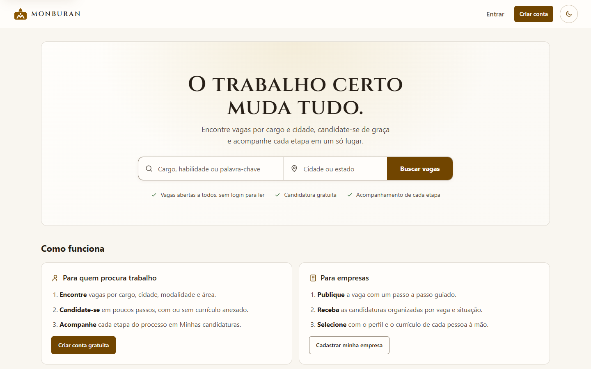 | 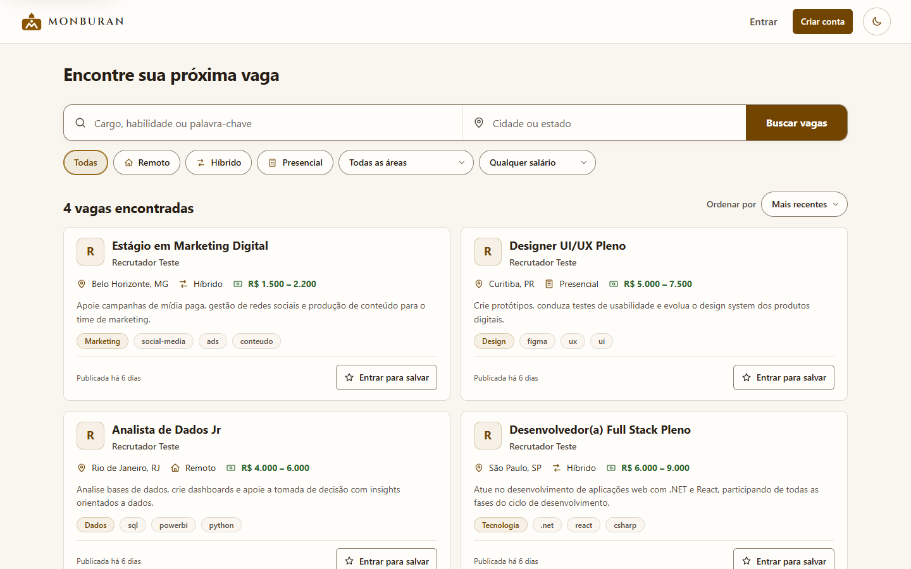 | 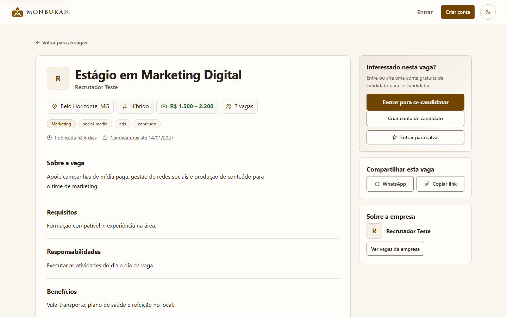 |

| Planos | Minhas candidaturas | Meus currículos |
|---|---|---|
| 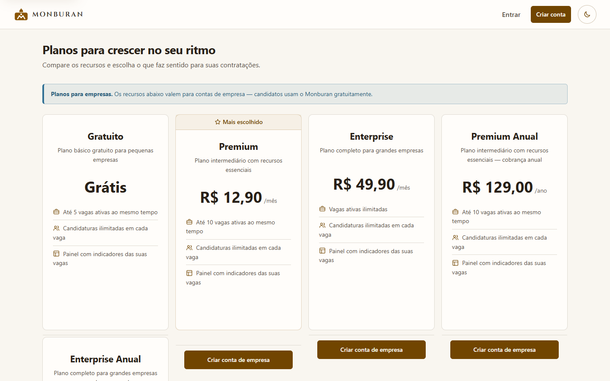 | 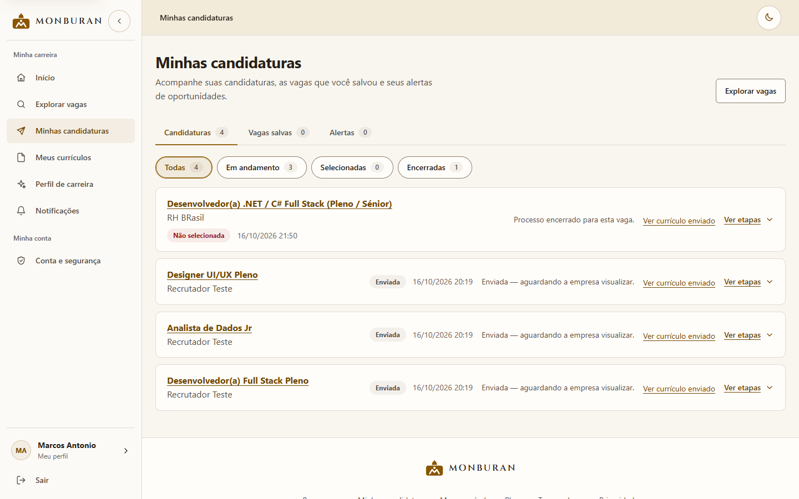 | 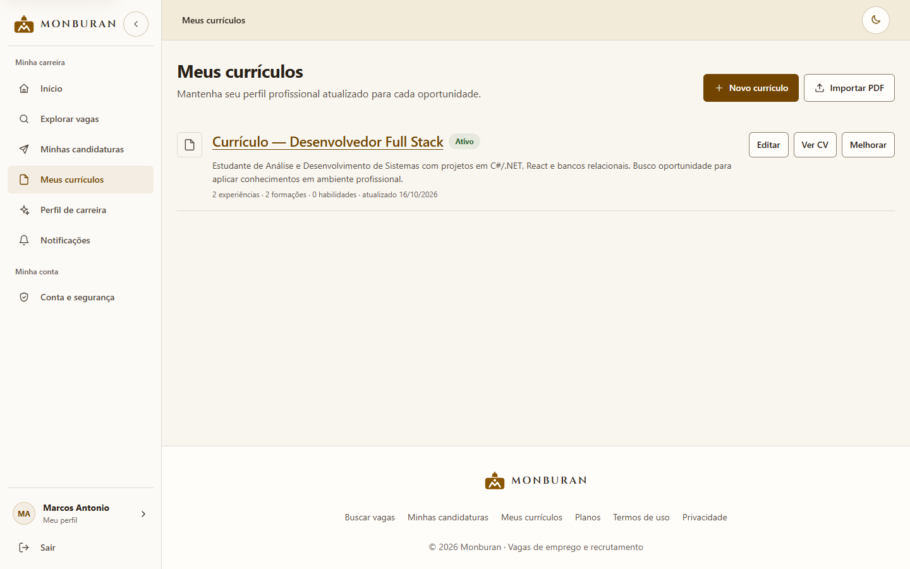 |

| Início (site em largura de celular) | Busca (site em largura de celular) |
|---|---|
| 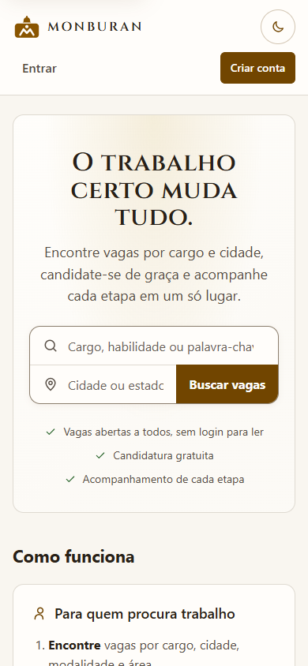 |  |

### Tema escuro

| Início | Busca de vagas | Detalhe da vaga |
|---|---|---|
|  | 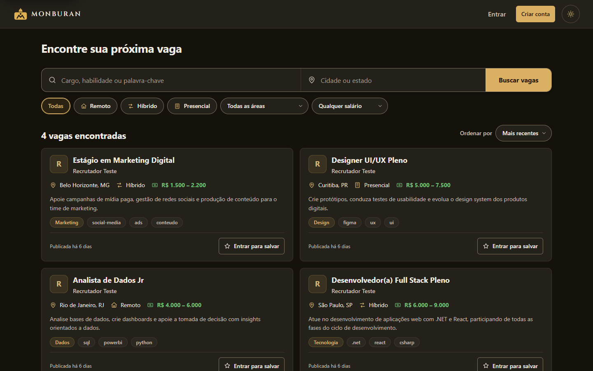 | 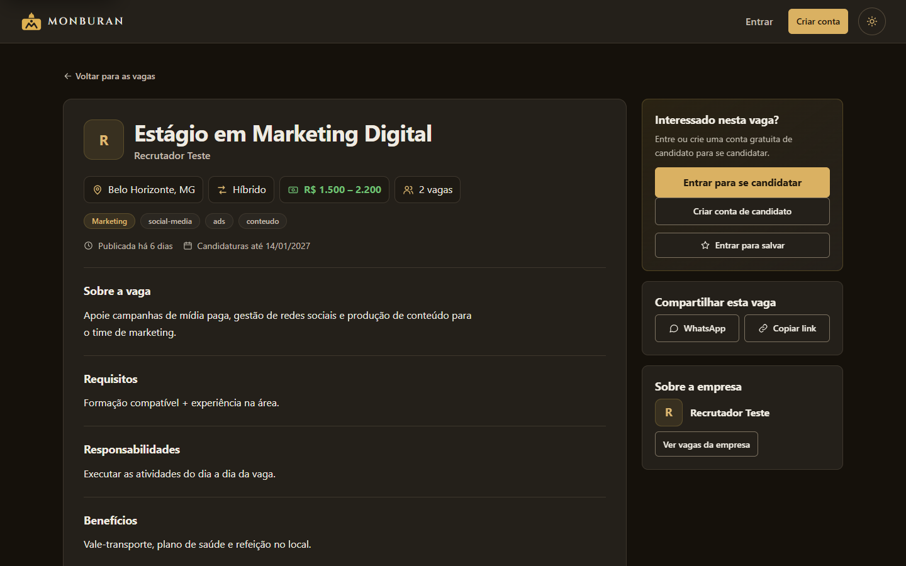 |

| Planos | Minhas candidaturas | Meus currículos |
|---|---|---|
| 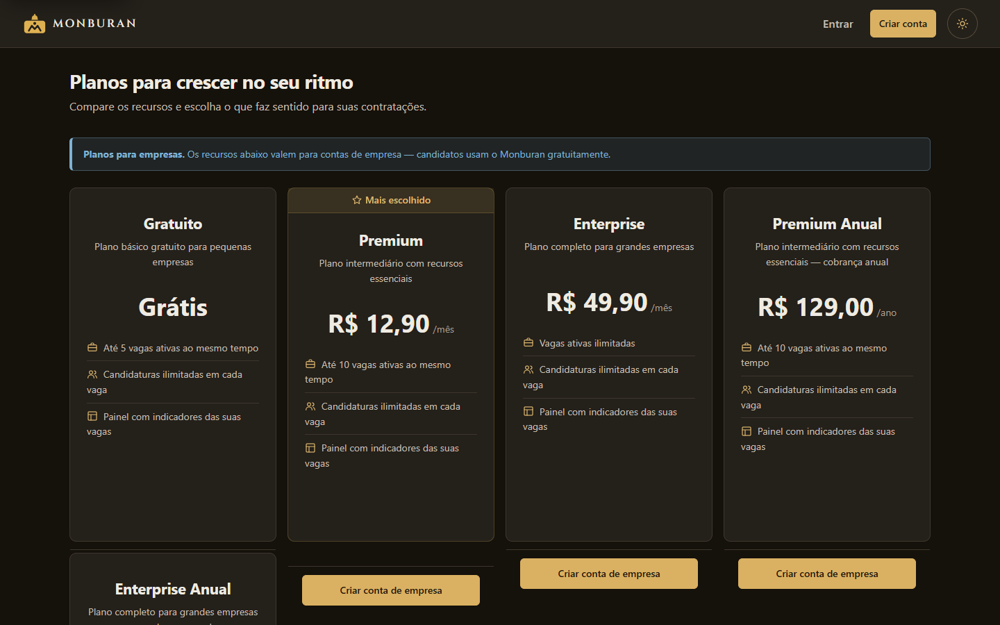 | 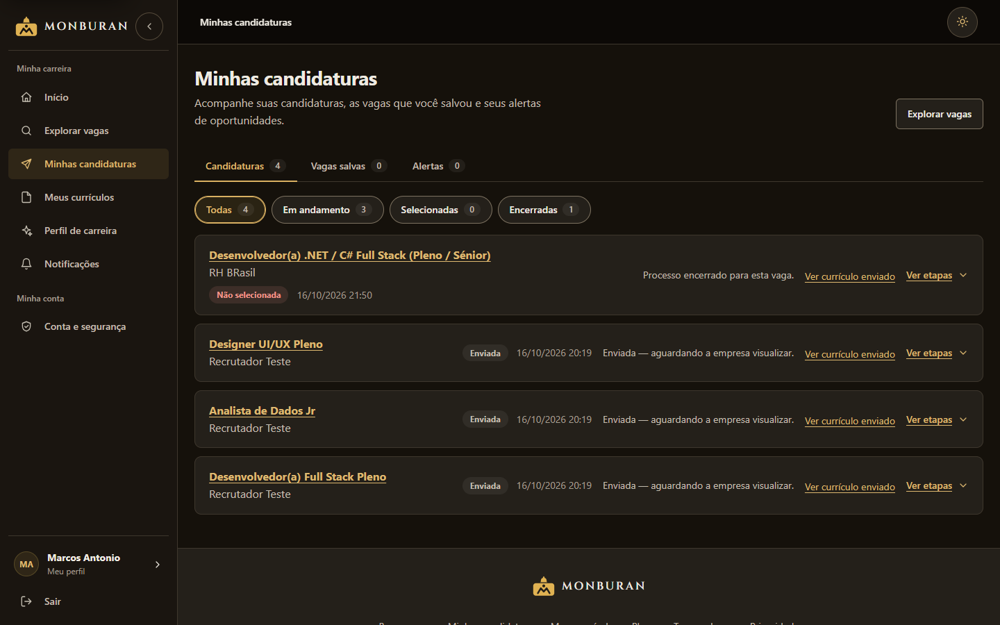 | 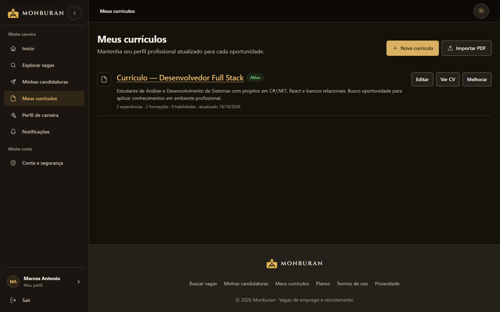 |

| Início (site em largura de celular) | Busca (site em largura de celular) |
|---|---|
| 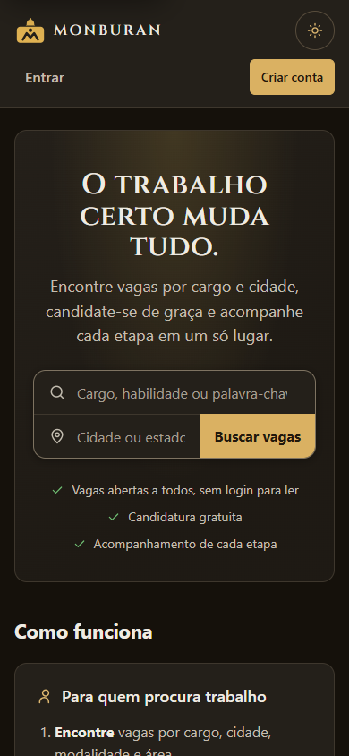 |  |

---

## 🔀 Fluxos

**Uso: candidato e empresa**

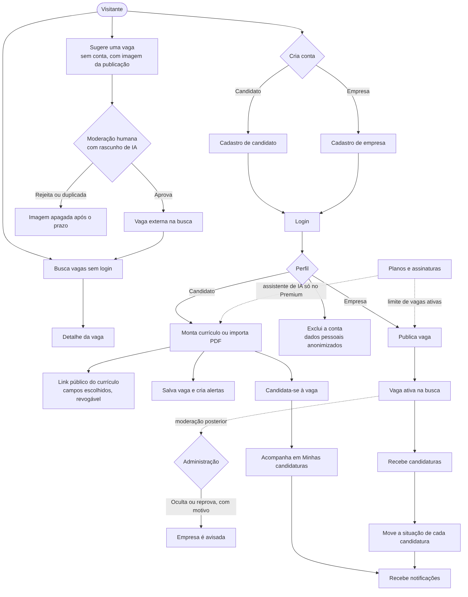

**Arquitetura**

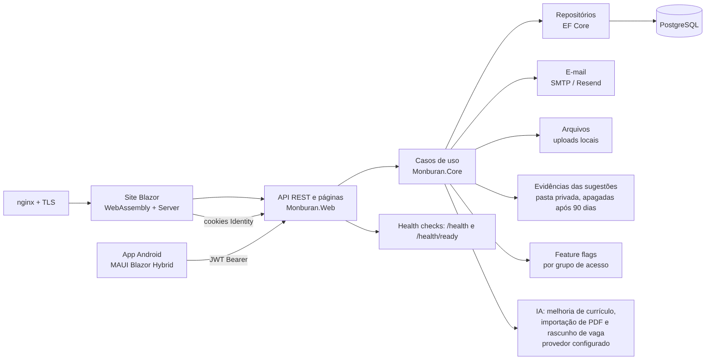

**Desenvolvimento e entrega** (branch → `dev` → `main` → produção)

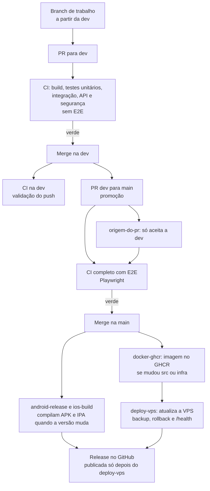

**Board (GitHub Projects)**

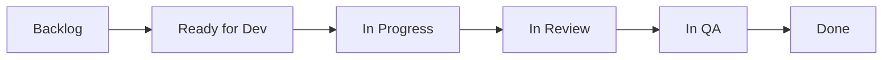

Versão em Mermaid, editável, em [docs/fluxo-projeto.md](docs/fluxo-projeto.md).

---

## ✨ Funcionalidades

- **Candidatos:** busca de vagas por cargo, cidade e salário; candidatura com ou sem currículo anexado; alertas de vagas; currículos com importação de PDF e link público com campos à escolha; acompanhamento de cada candidatura.
- **Empresas:** publicação e edição de vagas (a moderação é posterior, feita pela administração); recebimento de candidaturas por vaga; movimentação da situação de cada processo; perfil e logo da empresa.
- **Visitantes:** sugestão de vagas encontradas fora da plataforma, revisadas pela administração (viram vagas externas).
- **Plataforma:** cadastro e autenticação por perfil (ASP.NET Core Identity), API REST com JWT, notificações na plataforma e por e-mail, planos e assinaturas (sem cobrança por enquanto), IA para melhoria de currículo (plano Premium), importação de PDF e rascunho de vaga, feature flags por grupo de acesso.
- **Administração:** contas (inativar, reativar, 2FA e papéis), moderação de vagas e sugestões, trilha de auditoria, provedores de IA e feature flags.
- **Aplicativo Android:** o fluxo do **candidato** (sem telas de empresa), em .NET MAUI Blazor Hybrid, com token em armazenamento seguro, exclusão de conta pelo app e respeito às feature flags.

Lista completa e limites conhecidos: [IMPROVEMENTS.md](IMPROVEMENTS.md) e [PRODUCT.md](PRODUCT.md).

---

## 🛠 Stack

| Camada | Tecnologia |
|---|---|
| Backend | .NET 10 (ASP.NET Core), Entity Framework Core 10, PostgreSQL (Npgsql) |
| Web | Blazor WebAssembly + Server (Interactive Render Modes), design system próprio em CSS |
| Mobile | .NET MAUI Blazor Hybrid (Android) |
| Autenticação | ASP.NET Core Identity, JWT Bearer na API |
| E-mail | SMTP via MailKit (Resend em produção); SendGrid como alternativa |
| Testes | xUnit, NSubstitute, FluentAssertions, WebApplicationFactory, Testcontainers (PostgreSQL), Playwright (site), Appium (aplicativo) |
| Infra | Docker e Docker Compose, imagem no GHCR, VPS com nginx e TLS (certbot) |
| CI/CD | GitHub Actions |

---

## 🚀 Como executar

Pré-requisitos: [.NET 10 SDK](https://dotnet.microsoft.com/download/dotnet/10.0), o workload do Android (`dotnet workload install maui-android`: a solução inclui o aplicativo, então ele é necessário **até para `dotnet restore` e `dotnet build`**) e Docker, para o PostgreSQL.

```bash
# 1. Clonar e restaurar
git clone https://github.com/RondineleG/Monburan.git
cd Monburan
dotnet workload install maui-android
dotnet restore

# 2. Configuração do Docker Compose: copie o modelo e preencha a chave do JWT (obrigatória)
cp .env.example .env
openssl rand -base64 48     # cole o resultado em JWT_SIGNING_KEY, dentro do .env
# O banco do compose chama "monburan"; o appsettings.Development.json usa "monburan_dev".
# Para alinhar, defina também DB_NAME=monburan_dev no .env.

# 3. Banco de dados
docker compose up -d postgres

# 4. Executar (cria o esquema no boot; em Development o seed também roda)
APPLY_MIGRATIONS=true dotnet run --project src/Monburan.Web
# Site: http://localhost:5095    Swagger: http://localhost:5095/swagger
```

Pontos de atenção:

- **`JWT_SIGNING_KEY` é obrigatória no `.env`.** O Compose valida o arquivo inteiro: sem a chave, até `docker compose up -d postgres` falha com *"required variable JWT_SIGNING_KEY is missing a value"*. O `.env` é lido pelo Compose, não pelo `dotnet run`: em Development o `dotnet run` usa a chave de desenvolvimento do `appsettings.Development.json`.
- **`APPLY_MIGRATIONS=true`** aplica as migrations no boot. Sem ela o banco fica sem esquema (os arquivos `docker-compose.yml` e `docker-compose.dev.yml` também não a definem). Alternativa: `dotnet ef database update --project src/Monburan.Web` (exige `dotnet tool install --global dotnet-ef`).
- Em Windows (PowerShell), defina a variável antes: `$env:APPLY_MIGRATIONS = "true"; dotnet run --project src/Monburan.Web`.

Para o aplicativo Android, veja [docs/APP-MOBILE.md](docs/APP-MOBILE.md). Para produção e segredos, veja [docs/CONFIGURACAO.md](docs/CONFIGURACAO.md) e [DOCKER.md](DOCKER.md).

---

## 🔒 Segurança

- **Senhas:** mínimo de 10 caracteres, lista de senhas comuns recusada e bloqueio da conta após 5 erros (15 minutos).
- **Limites:** rate limiting por IP (50 req/s no site e 20 envios/min em login, cadastro e recuperação de senha).
- **Sessão:** cookies `Secure` e `HttpOnly`; chaves de sessão persistidas.
- **Cabeçalhos:** CSP sem `unsafe-inline` nem `unsafe-eval` nos scripts, HSTS e demais cabeçalhos de segurança.
- **Administração:** 2FA obrigatório para administradores e auditoria de toda ação administrativa.
- **VPS:** firewall só com SSH, 80 e 443; SSH só por chave; fail2ban; backup criptografado fora do servidor.
- **Repositório:** Dependabot, CodeQL e scan de segredos no CI.

Detalhes e passo a passo para produção: [docs/SEGURANCA.md](docs/SEGURANCA.md).

---

## 📊 Monitoramento

- **Health checks:** `/health` e `/health/live` indicam que a aplicação está no ar, sem depender do banco. `/health/ready` verifica o PostgreSQL e responde 503 quando o banco não responde.
- **Logs:** Serilog, com saída no console e em arquivo com rotação diária. Nível Information; `Microsoft` e `System` em Warning.

---

## 📚 Documentação

| Documento | Conteúdo |
|---|---|
| [Wiki](https://github.com/RondineleG/Monburan/wiki) | Visão do produto, arquitetura, modelo de dados, regras de negócio, API, site, aplicativo, testes, CI/CD, produção e pendências |
| [docs/API.md](docs/API.md) | Endpoints `/api/auth` e `/api/v1`, JWT e modelos de dados |
| [docs/CONFIGURACAO.md](docs/CONFIGURACAO.md) | Arquivos de configuração, segredos, e-mail e IA |
| [docs/APP-MOBILE.md](docs/APP-MOBILE.md) | Aplicativo Android: estrutura e execução |
| [docs/SEGURANCA.md](docs/SEGURANCA.md) | Medidas de segurança e checklist de produção |
| [docs/CI-CD.md](docs/CI-CD.md) | Workflows, publicação de versões e deploy |
| [.github/workflows/README.md](.github/workflows/README.md) | Gatilhos, checks obrigatórios e permissões |
| [DOCKER.md](DOCKER.md) | Docker e deploy na VPS |
| [docs/IA-PROVEDORES.md](docs/IA-PROVEDORES.md) e [docs/IA-CURRICULO.md](docs/IA-CURRICULO.md) | Provedores de IA e privacidade das sugestões |
| [docs/FEATURE-FLAGS.md](docs/FEATURE-FLAGS.md) | Feature flags por grupo de acesso e regra para funcionalidades novas |
| [docs/pre-prod.md](docs/pre-prod.md) | Checklist de pré-produção |
| [TEST_STRATEGY.md](TEST_STRATEGY.md) | Estratégia e camadas de testes |
| [IMPROVEMENTS.md](IMPROVEMENTS.md) | Melhorias implementadas e pendências |

Estrutura do repositório, em resumo:

```
src/
  Monburan.Core/            domínio, casos de uso e validações
  Monburan.Web/             site Blazor, API REST, repositórios e migrations
  Monburan.Web.Client/      estado de autenticação no navegador (sem páginas)
  Monburan.Mobile.Shared/   camada compartilhada do aplicativo
  Monburan.Mobile/          aplicativo MAUI Blazor Hybrid (Android)
tests/                      unitários, integração, API, E2E, telas do app (Appium) e pré-visualizações
infra/vps/                  scripts e stack de produção na VPS
docs/                       documentação técnica, prints e fluxogramas
.github/workflows/          pipelines do GitHub Actions
```

---

## 🤝 Contribuindo

1. Crie uma branch a partir da `dev`.
2. Faça as mudanças e abra um Pull Request **para a `dev`**.
3. A `main` recebe apenas promoções da `dev`, por Pull Request.
4. Commits no padrão Conventional Commits, em português, um assunto por commit (`tipo(escopo): descrição`).

Passo a passo, regras de commit e checklist do PR: [Como contribuir](https://github.com/RondineleG/Monburan/wiki/Como-contribuir) na wiki e o [AGENTS.md](AGENTS.md).

Padrões: nullable habilitado, `sealed` em classes de serviço, logging com `ILogger<T>` (não use `Console.Write`).

---

## 📄 Licença

Este projeto está licenciado sob a [MIT License](LICENSE).

<details>
<summary>Texto da licença</summary>

```
MIT License

Copyright (c) 2026 Monburan

Permission is hereby granted, free of charge, to any person obtaining a copy
of this software and associated documentation files (the "Software"), to deal
in the Software without restriction, including without limitation the rights
to use, copy, modify, merge, publish, distribute, sublicense, and/or sell
copies of the Software, and to permit persons to whom the Software is
furnished to do so, subject to the following conditions:

The above copyright notice and this permission notice shall be included in all
copies or substantial portions of the Software.

THE SOFTWARE IS PROVIDED "AS IS", WITHOUT WARRANTY OF ANY KIND, EXPRESS OR
IMPLIED, INCLUDING BUT NOT LIMITED TO THE WARRANTIES OF MERCHANTABILITY,
FITNESS FOR A PARTICULAR PURPOSE AND NONINFRINGEMENT. IN NO EVENT SHALL THE
AUTHORS OR COPYRIGHT HOLDERS BE LIABLE FOR ANY CLAIM, DAMAGES OR OTHER
LIABILITY, WHETHER IN AN ACTION OF CONTRACT, TORT OR OTHERWISE, ARISING FROM,
OUT OF OR IN CONNECTION WITH THE SOFTWARE OR THE USE OR OTHER DEALINGS IN THE
SOFTWARE.
```

</details>

---

Feito com ❤️ por [Equipe Monburan](https://github.com/RondineleG)
