# 🚀 Monburan


> **Plataforma de recrutamento que conecta candidatos e empresas que publicam vagas.**

O Monburan é uma aplicação web e um aplicativo Android para anunciar vagas, receber candidaturas e acompanhar cada etapa do processo. Está construído com **.NET 10**, **Blazor** (WebAssembly e Server) e **.NET MAUI Blazor Hybrid** para Android.

- 🌐 **Site:** https://monburan.com.br
- 📱 **Aplicativo Android (v1.5.0):** [release no GitHub](https://github.com/RondineleG/Monburan/releases/tag/v1.5.0)
- 📋 **Board de gestão:** https://github.com/users/RondineleG/projects/14

---

## 🖼️ Telas

Capturas do site em produção, nos dois temas (o site segue a preferência do usuário).

### Tema claro

| Início | Busca de vagas | Detalhe da vaga |
|---|---|---|
| 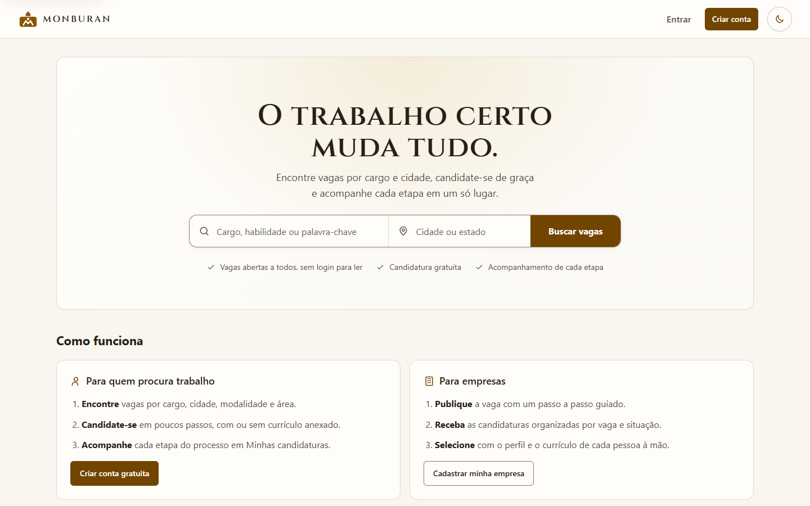 | 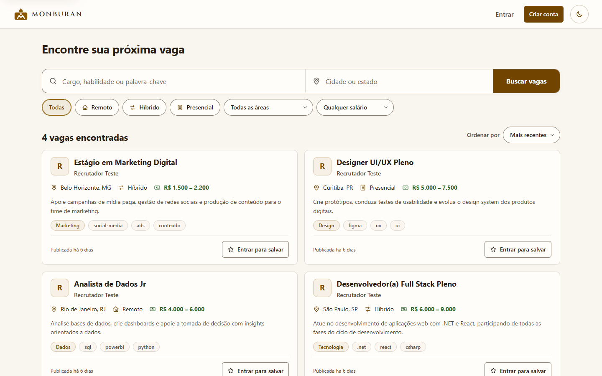 | 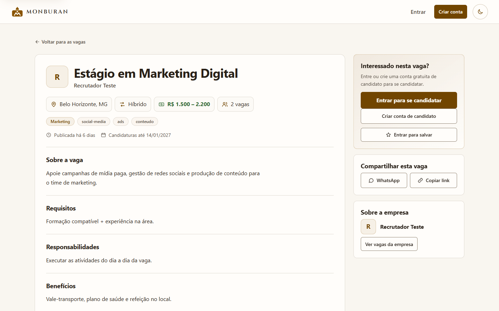 |

| Planos | Minhas candidaturas | Meus currículos |
|---|---|---|
| 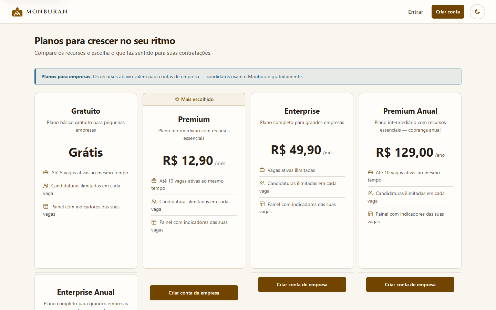 | 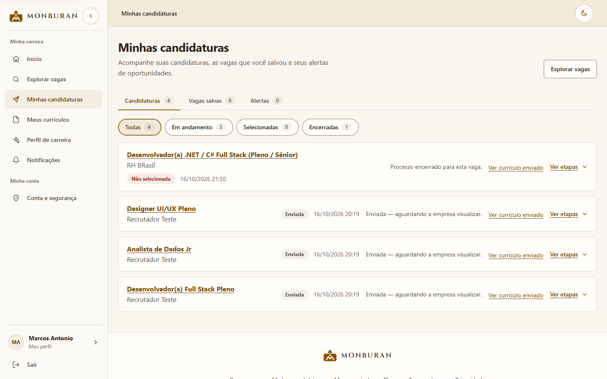 | 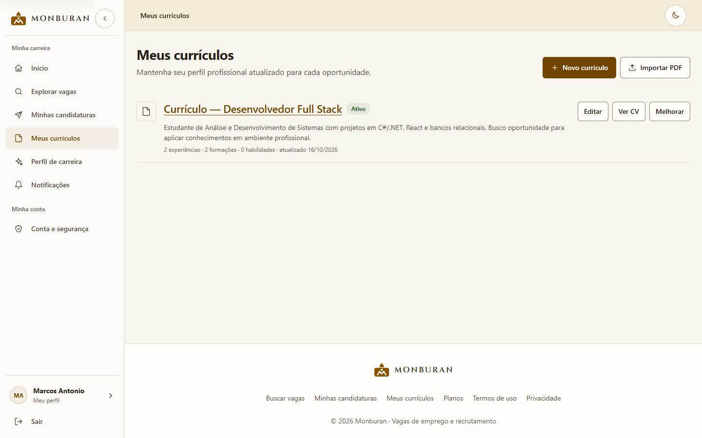 |

| Início (site em largura de celular) | Busca (site em largura de celular) |
|---|---|
| 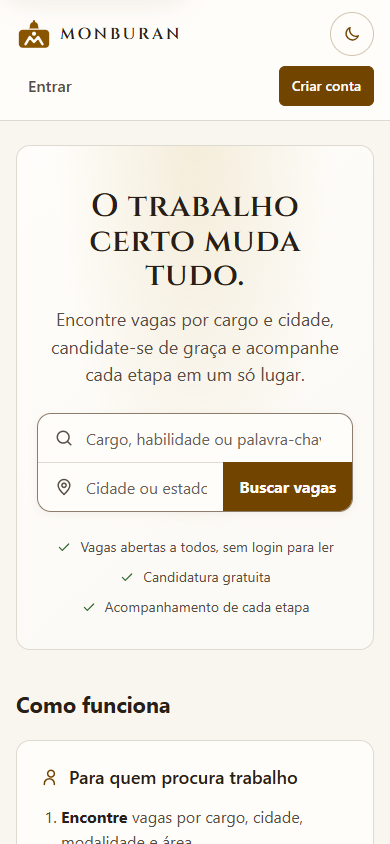 |  |

### Tema escuro

| Início | Busca de vagas | Detalhe da vaga |
|---|---|---|
|  | 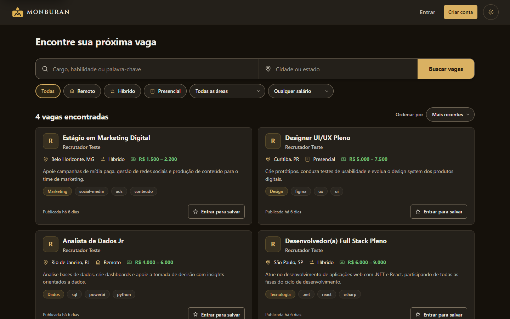 | 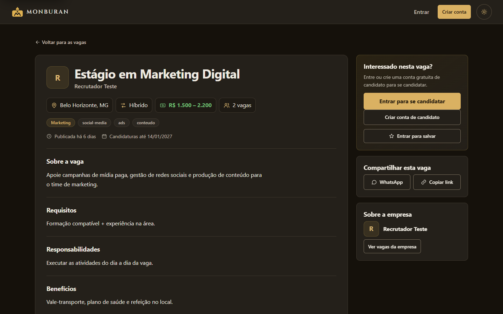 |

| Planos | Minhas candidaturas | Meus currículos |
|---|---|---|
| 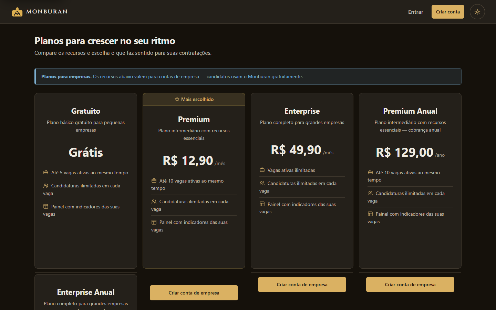 | 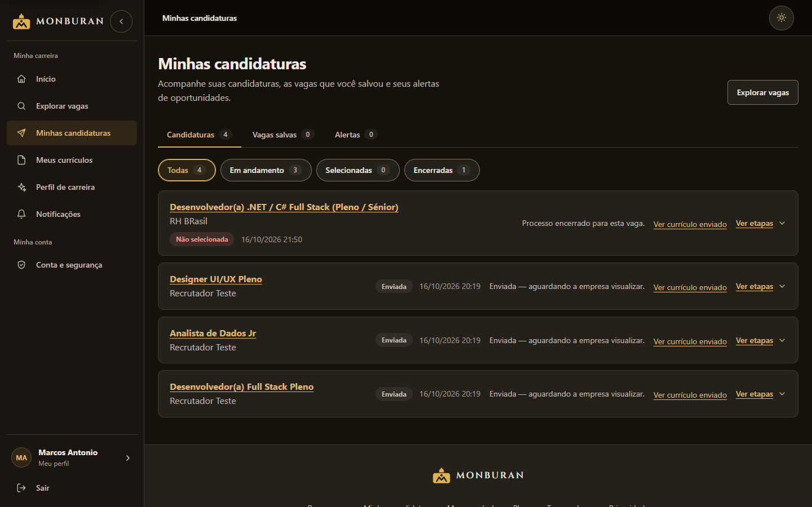 | 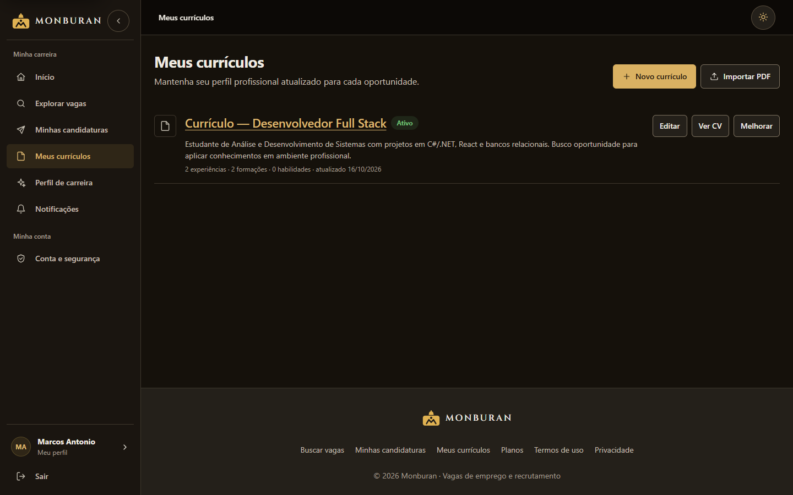 |

| Início (site em largura de celular) | Busca (site em largura de celular) |
|---|---|
| 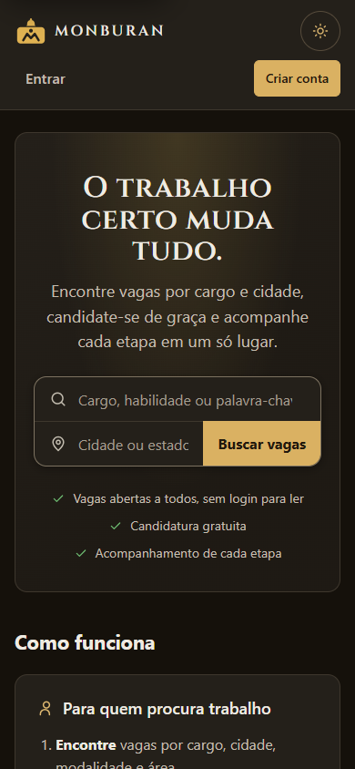 |  |

---

## 🔀 Fluxos

**Uso: candidato e empresa**

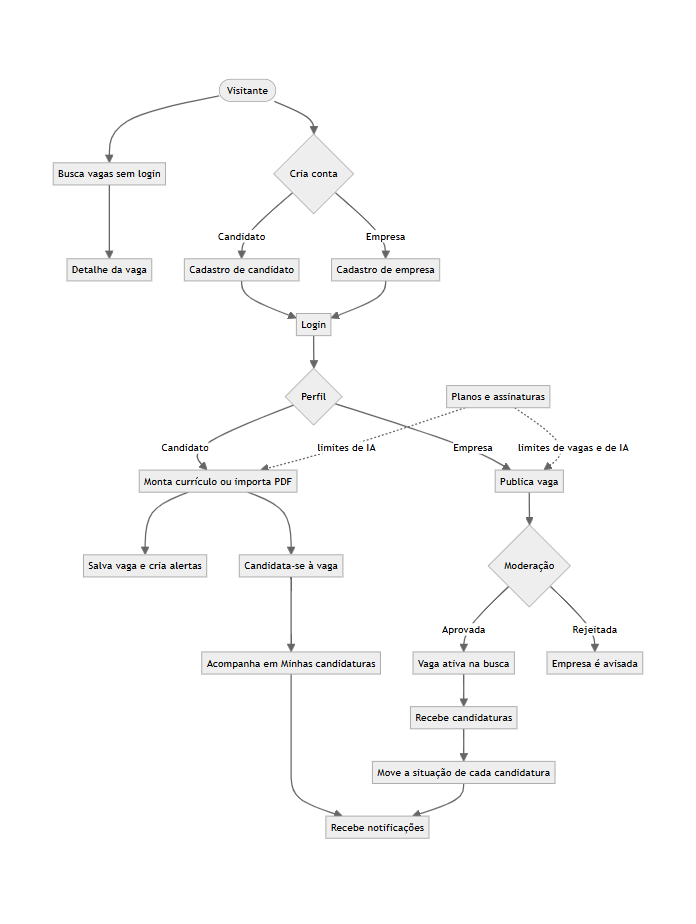

**Arquitetura**

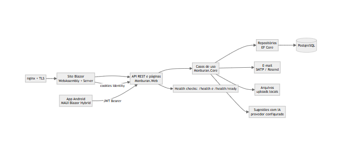

**Desenvolvimento e entrega** (branch → `dev` → `main` → produção)

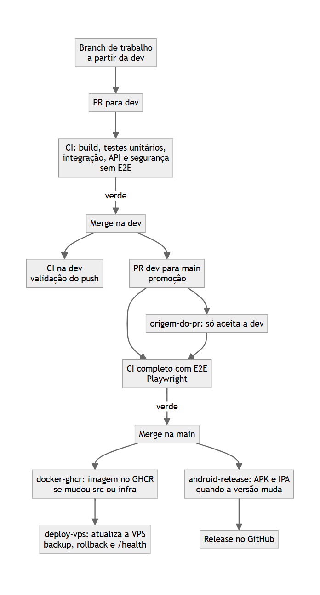

**Board (GitHub Projects)**

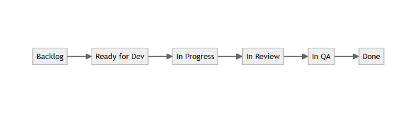

Versão em Mermaid, editável, em [docs/fluxo-projeto.md](docs/fluxo-projeto.md).

---

## ✨ Funcionalidades

- **Candidatos:** busca de vagas por cargo, cidade e salário; candidatura com ou sem currículo anexado; alertas de vagas; currículos com importação de PDF; acompanhamento de cada candidatura.
- **Empresas:** publicação e edição de vagas com moderação; recebimento de candidaturas por vaga; movimentação da situação de cada processo; perfil e logo da empresa.
- **Plataforma:** cadastro e autenticação por perfil (ASP.NET Core Identity), API REST com JWT, notificações na plataforma e por e-mail, planos e assinaturas, sugestões de melhoria de currículo com IA (plano Premium).
- **Administração:** contas (inativar, reativar, 2FA e papéis), moderação de vagas, trilha de auditoria e provedores de IA.
- **Aplicativo Android:** o mesmo fluxo do site, em .NET MAUI Blazor Hybrid, com token em armazenamento seguro.

Lista completa e limites conhecidos: [IMPROVEMENTS.md](IMPROVEMENTS.md) e [PRODUCT.md](PRODUCT.md).

---

## 🛠 Stack

| Camada | Tecnologia |
|---|---|
| Backend | .NET 10 (ASP.NET Core), Entity Framework Core 10, PostgreSQL (Npgsql) |
| Web | Blazor WebAssembly + Server (Interactive Render Modes), design system próprio em CSS |
| Mobile | .NET MAUI Blazor Hybrid (Android) |
| Autenticação | ASP.NET Core Identity, JWT Bearer na API |
| E-mail | SMTP via MailKit (Resend em produção); SendGrid como alternativa |
| Testes | xUnit, NSubstitute, FluentAssertions, WebApplicationFactory, Testcontainers (PostgreSQL), Playwright |
| Infra | Docker e Docker Compose, imagem no GHCR, VPS com nginx e TLS (certbot) |
| CI/CD | GitHub Actions |

---

## 🚀 Como executar

Pré-requisitos: [.NET 10 SDK](https://dotnet.microsoft.com/download/dotnet/10.0), PostgreSQL (ou `docker compose up -d postgres`) e a CLI do EF Core (`dotnet tool install --global dotnet-ef`).

```bash
# 1. Clonar e restaurar
git clone https://github.com/RondineleG/Monburan.git
cd Monburan
dotnet restore

# 2. Banco de dados
docker compose up -d postgres
dotnet ef database update --project src/Monburan.Web   # o seed roda no boot em Development

# 3. Executar
dotnet run --project src/Monburan.Web
# Site: http://localhost:5095    Swagger: http://localhost:5095/swagger
```

O compose cria o banco `monburan` por padrão; o `appsettings.Development.json` usa `monburan_dev`. Para alinhar, defina `DB_NAME=monburan_dev` no `.env`.

Para o aplicativo Android, veja [docs/APP-MOBILE.md](docs/APP-MOBILE.md). Para produção e segredos, veja [docs/CONFIGURACAO.md](docs/CONFIGURACAO.md) e [DOCKER.md](DOCKER.md).

---

## 🔒 Segurança

- **Senhas:** mínimo de 10 caracteres, lista de senhas comuns recusada e bloqueio da conta após 5 erros (15 minutos).
- **Limites:** rate limiting por IP (50 req/s no site e 20 envios/min em login, cadastro e recuperação de senha).
- **Sessão:** cookies `Secure` e `HttpOnly`; chaves de sessão persistidas.
- **Cabeçalhos:** CSP sem `unsafe-inline` nem `unsafe-eval` nos scripts, HSTS e demais cabeçalhos de segurança.
- **Administração:** 2FA obrigatório para administradores e auditoria de toda ação administrativa.
- **VPS:** firewall só com SSH, 80 e 443; SSH só por chave; fail2ban; backup criptografado fora do servidor.
- **Repositório:** Dependabot, CodeQL e scan de segredos no CI.

Detalhes e passo a passo para produção: [docs/SEGURANCA.md](docs/SEGURANCA.md).

---

## 📊 Monitoramento

- **Health checks:** `/health` e `/health/live` indicam que a aplicação está no ar, sem depender do banco. `/health/ready` verifica o PostgreSQL e responde 503 quando o banco não responde.
- **Logs:** Serilog, com saída no console e em arquivo com rotação diária. Nível Information; `Microsoft` e `System` em Warning.

---

## 📚 Documentação

| Documento | Conteúdo |
|---|---|
| [docs/API.md](docs/API.md) | Endpoints `/api/auth` e `/api/v1`, JWT e modelos de dados |
| [docs/CONFIGURACAO.md](docs/CONFIGURACAO.md) | Arquivos de configuração, segredos, e-mail e IA |
| [docs/APP-MOBILE.md](docs/APP-MOBILE.md) | Aplicativo Android: estrutura e execução |
| [docs/SEGURANCA.md](docs/SEGURANCA.md) | Medidas de segurança e checklist de produção |
| [docs/CI-CD.md](docs/CI-CD.md) | Workflows, publicação de versões e deploy |
| [.github/workflows/README.md](.github/workflows/README.md) | Gatilhos, checks obrigatórios e permissões |
| [DOCKER.md](DOCKER.md) | Docker e deploy na VPS |
| [docs/IA-PROVEDORES.md](docs/IA-PROVEDORES.md) e [docs/IA-CURRICULO.md](docs/IA-CURRICULO.md) | Provedores de IA e privacidade das sugestões |
| [IMPROVEMENTS.md](IMPROVEMENTS.md) | Melhorias implementadas e pendências |

Estrutura do repositório, em resumo:

```
src/
  Monburan.Core/            domínio, casos de uso e validações
  Monburan.Web/             site Blazor, API REST, repositórios e migrations
  Monburan.Mobile.Shared/   camada compartilhada do aplicativo
  Monburan.Mobile/          aplicativo MAUI Blazor Hybrid (Android)
tests/                      unitários, integração, API, E2E e pré-visualizações
infra/vps/                  scripts e stack de produção na VPS
docs/                       documentação técnica, prints e fluxogramas
.github/workflows/          pipelines do GitHub Actions
```

---

## 🤝 Contribuindo

1. Crie uma branch a partir da `dev`.
2. Faça as mudanças e abra um Pull Request **para a `dev`**.
3. A `main` recebe apenas promoções da `dev`, por Pull Request.

Padrões: nullable habilitado, `sealed` em classes de serviço, logging com `ILogger<T>` (não use `Console.Write`).

---

## 📄 Licença

Este projeto está licenciado sob a [MIT License](LICENSE).

<details>
<summary>Texto da licença</summary>

```
MIT License

Copyright (c) 2026 Monburan

Permission is hereby granted, free of charge, to any person obtaining a copy
of this software and associated documentation files (the "Software"), to deal
in the Software without restriction, including without limitation the rights
to use, copy, modify, merge, publish, distribute, sublicense, and/or sell
copies of the Software, and to permit persons to whom the Software is
furnished to do so, subject to the following conditions:

The above copyright notice and this permission notice shall be included in all
copies or substantial portions of the Software.

THE SOFTWARE IS PROVIDED "AS IS", WITHOUT WARRANTY OF ANY KIND, EXPRESS OR
IMPLIED, INCLUDING BUT NOT LIMITED TO THE WARRANTIES OF MERCHANTABILITY,
FITNESS FOR A PARTICULAR PURPOSE AND NONINFRINGEMENT. IN NO EVENT SHALL THE
AUTHORS OR COPYRIGHT HOLDERS BE LIABLE FOR ANY CLAIM, DAMAGES OR OTHER
LIABILITY, WHETHER IN AN ACTION OF CONTRACT, TORT OR OTHERWISE, ARISING FROM,
OUT OF OR IN CONNECTION WITH THE SOFTWARE OR THE USE OR OTHER DEALINGS IN THE
SOFTWARE.
```

</details>

---

Feito com ❤️ por [Equipe Monburan](https://github.com/RondineleG)
