# Evidência — testes de tela do app Android (Etapa 2)

Registro da validação do aplicativo Monburan por **testes automatizados de tela em emulador Android**, executados no
GitHub Actions. Os artefatos do GitHub expiram em 7 dias, por isso o resultado está guardado aqui.

## Resultado

**7 de 7 testes aprovados, 0 falhas**, na execução 8 do workflow `Mobile UI (Appium)`.

| Item | Valor |
|---|---|
| Execução | <https://github.com/RondineleG/Monburan/actions/runs/41364600639> |
| Commit testado | `be0d425` (branch `fix/mobile-ui-appium-versoes`) |
| Data | 01/11/2026 (workflow iniciado às 20:57, horário de Brasília) |
| Duração da suíte de testes | 3 min 18 s (das 21:02:56 às 21:06:14, horário de Brasília) |
| Relatório bruto (TRX) | [`mobile-ui-etapa2.trx`](mobile-ui-etapa2.trx) |
| Pull request com as correções | <https://github.com/RondineleG/Monburan/pull/87> |

### Ambiente

| Componente | Versão |
|---|---|
| Emulador | Android 14 (API 34, `google_apis`, x86_64, perfil Pixel 6), no runner `ubuntu-latest` |
| Aplicativo | APK **Debug** `com.monburan.app` 1.6.0 (build 6), gerado no próprio job a partir do commit testado |
| Automação | Appium 3.9.0, driver UiAutomator2 8.7.3 (servidor UiAutomator2 v10.7.6), cliente Appium.WebDriver 9.0.0 (C#) |
| Framework de testes | xUnit 2.9.3, .NET 10 |
| API usada pelo app | API do próprio repositório em modo Development (massa de demonstração), PostgreSQL 16 do serviço do job, ligada ao emulador por `adb reverse` |

### Testes e duração

| Teste | Resultado | Duração |
|---|---|---|
| `FirstLaunch_WithoutSession_ShowsTheWelcomeScreen` — primeira abertura sem sessão mostra as boas-vindas | Aprovado | 45 s |
| `Login_WithAWrongPassword_ShowsTheError_AndStaysOnLogin` — senha errada mostra o erro e permanece no login | Aprovado | 15 s |
| `Login_WithValidCredentials_OpensTheDashboard_WithTheBottomNavigation` — login válido abre o painel com a barra de navegação | Aprovado | 20 s |
| `Session_SurvivesClosingAndReopeningTheApp` — a sessão sobrevive a fechar e reabrir o app | Aprovado | 43 s |
| `Logout_GoesToTheLoginScreen_AndTheSessionIsGone` — sair da conta leva ao login e a sessão some ao reabrir | Aprovado | 35 s |
| `Jobs_ListsTheOpenJobs_AndOpensTheDetails` — lista as vagas e abre o detalhe | Aprovado | 18 s |
| `Jobs_SearchWithNoMatch_ShowsTheEmptyState` — busca sem resultado mostra o estado vazio | Aprovado | 20 s |

Cada teste apaga os dados do app, cria uma conta de candidato nova pela API e interage com o app instalado: toca em
botões, digita nos campos e lê o que aparece na tela (a tela do app é uma WebView do Blazor Hybrid).

## Imagens dos testes

Telas reais do aplicativo no emulador, capturadas pelos próprios testes (tela inteira, com a barra de status do
Android). Todas vêm de execuções em que os 7 testes foram aprovados: as imagens 01, 02, 03, 08, 09 e 10 da execução
41369620671, e a 05 e a 06 da execução 41371426060. Os dados que aparecem (e-mail com sufixo aleatório, "Candidato Teste
de Tela") são de contas criadas só para o teste; as vagas vêm da massa de demonstração.

| Imagem | Teste | O que mostra |
|---|---|---|
| 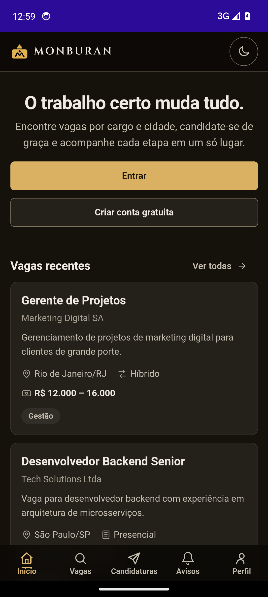 | `FirstLaunch_WithoutSession_ShowsTheWelcomeScreen` | Primeira abertura sem sessão: título "O trabalho certo muda tudo.", botões *Entrar* e *Criar conta gratuita*, vagas recentes |
| 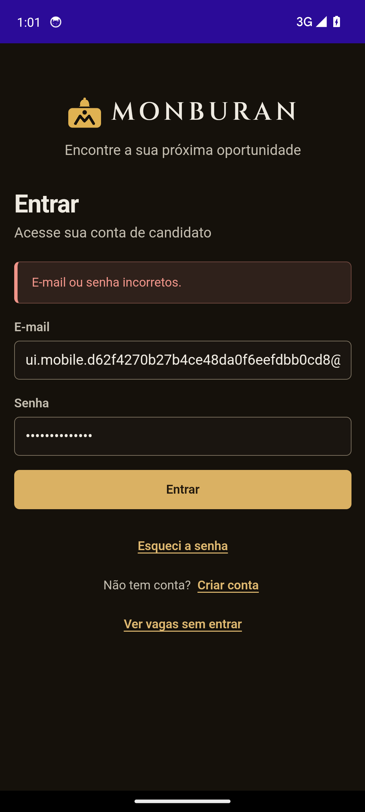 | `Login_WithAWrongPassword_...` | Mensagem "E-mail ou senha incorretos." e o formulário preenchido, sem entrar |
| 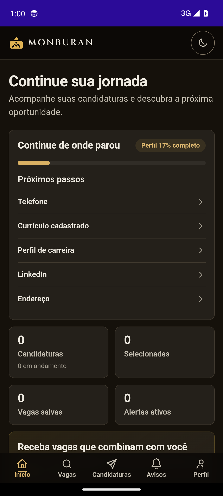 | `Login_WithValidCredentials_...` | Painel "Continue sua jornada", perfil 17% completo, contadores e a barra inferior com Início, Vagas, Candidaturas, Avisos e Perfil |
| 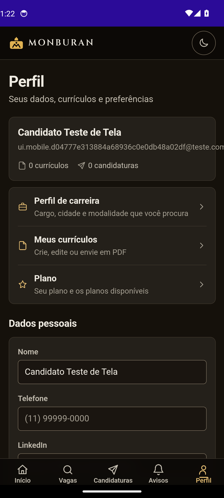 | `Logout_GoesToTheLoginScreen_...` | Tela Perfil da conta, de onde o teste toca em *Sair da conta* |
| 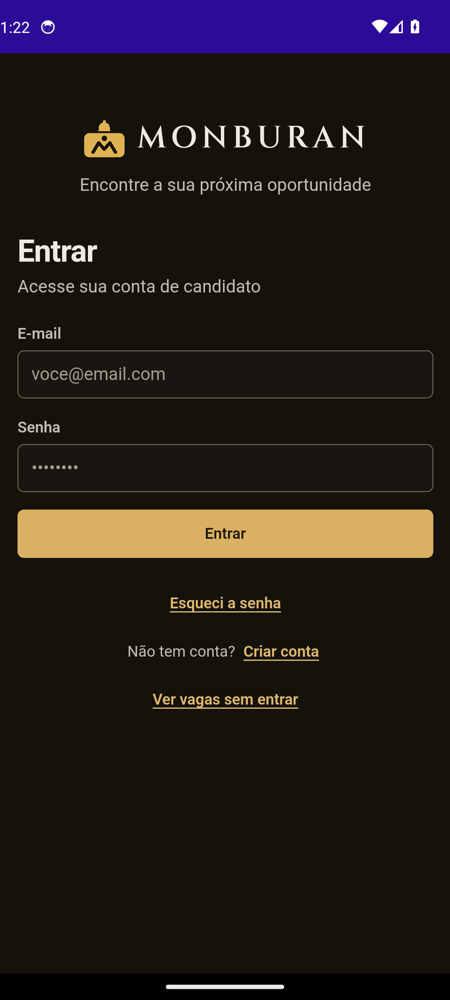 | `Logout_GoesToTheLoginScreen_...` | Depois de sair da conta, o app volta à tela de login |
| 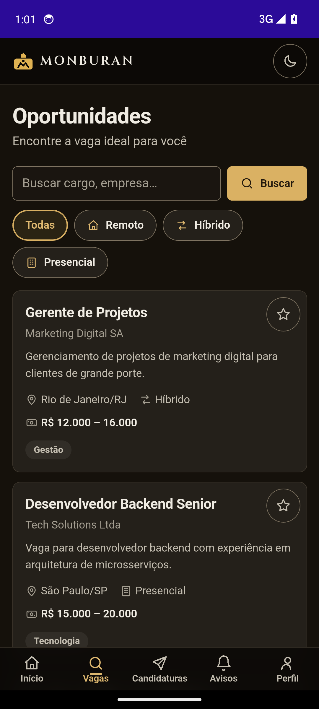 | `Jobs_ListsTheOpenJobs_...` | "Oportunidades": busca, filtros de modalidade e cartões de vagas |
| 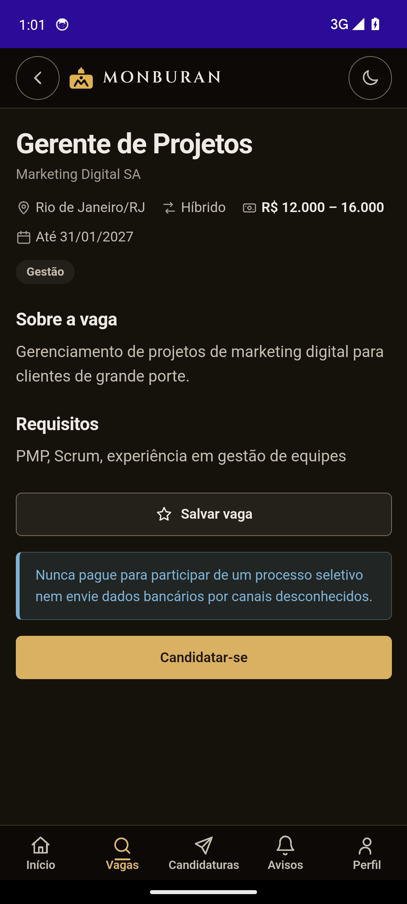 | `Jobs_ListsTheOpenJobs_...` | Detalhe de "Gerente de Projetos" com local, modalidade, salário, requisitos e *Candidatar-se* |
| 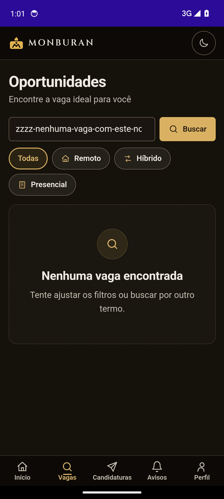 | `Jobs_SearchWithNoMatch_...` | Busca sem correspondência: "Nenhuma vaga encontrada" |

### Imagens da segunda leva de testes (17 testes novos)

A suíte foi ampliada de 7 para **24 testes**. As imagens abaixo vêm da execução 41376619916 (23 de 24 aprovados; o
teste que falhou nessa rodada não gera imagem). As oito foram revisadas uma a uma.

| Imagem | Teste | O que mostra |
|---|---|---|
| 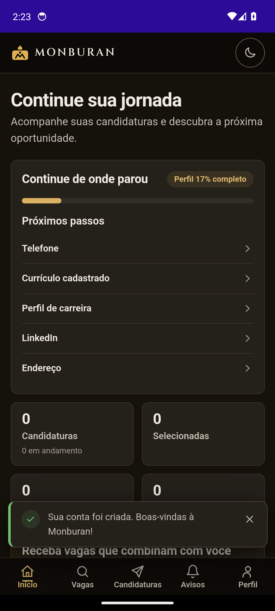 | `Register_WithValidData_...` | Conta criada pelo formulário: o app entra no painel e mostra "Sua conta foi criada. Boas-vindas à Monburan!" |
| 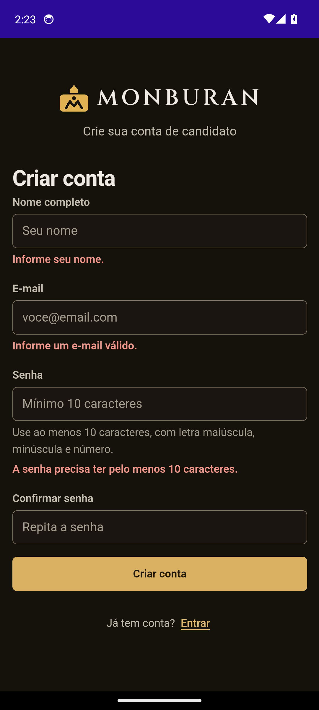 | `Register_WithAnEmptyForm_...` | Formulário vazio: "Informe seu nome.", "Informe um e-mail válido." e "A senha precisa ter pelo menos 10 caracteres." |
| 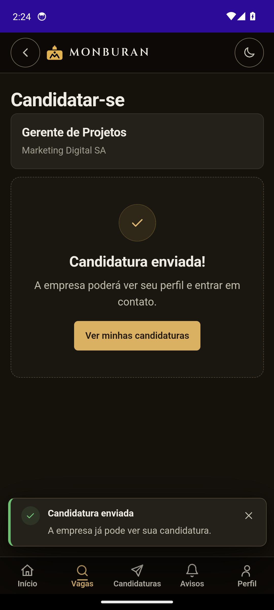 | `Apply_ToAnOpenJob_...` | "Candidatura enviada!" para a vaga "Gerente de Projetos", com o aviso de confirmação |
| 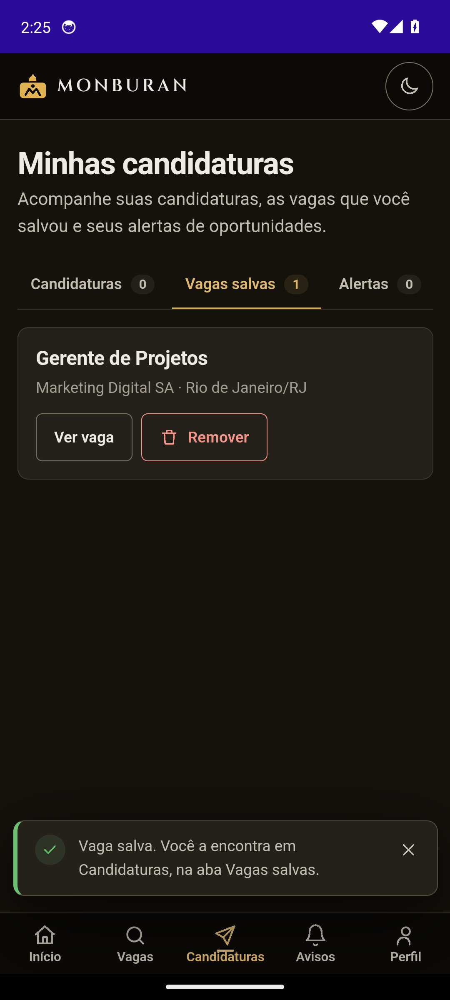 | `SaveJob_FromTheList_...` | Aba *Vagas salvas* com 1 vaga, depois de salvar pela lista |
| 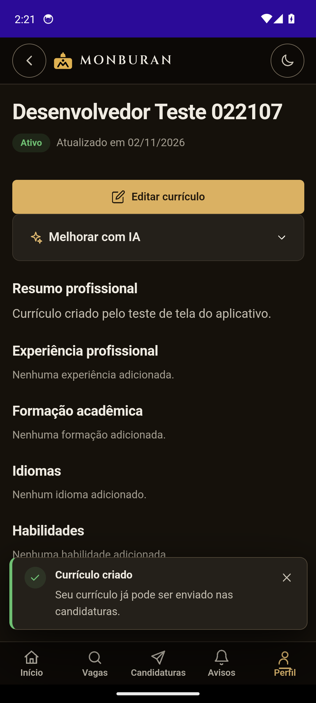 | `Resume_Create_AppearsInTheList` | Detalhe do currículo recém-criado (ativo, com o resumo digitado) e a mensagem "Currículo criado" |
| 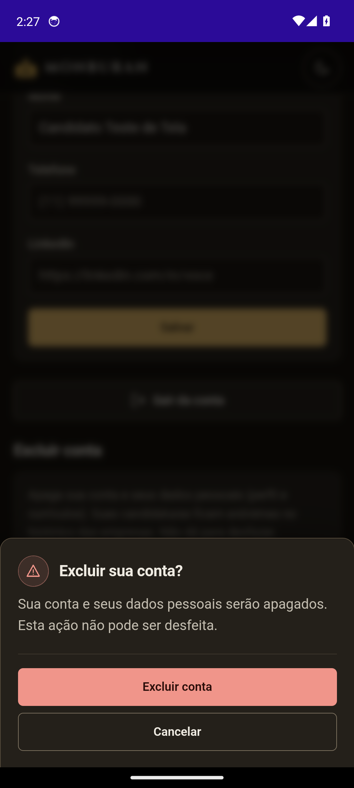 | `DeleteAccount_WithTheRightPassword_...` | Diálogo "Excluir sua conta?" com *Excluir conta* e *Cancelar* |
| 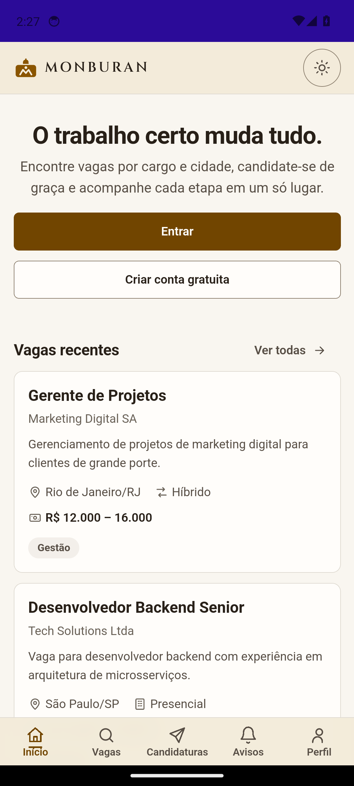 | `ThemeToggle_...` | O app em tema claro depois de tocar no botão de tema |
| 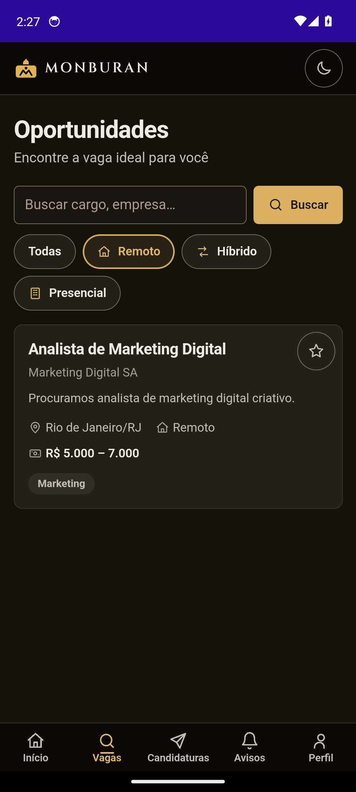 | `Jobs_FilteredByRemote_...` | Filtro *Remoto* ativo e só a vaga remota na lista |

Testes novos sem imagem própria: senhas diferentes e senha curta no cadastro, login com campos vazios, título do
currículo vazio e curto, exclusão de conta sem senha e cancelada, lista de candidaturas vazia e navegação pela barra
inferior.

## Ponto em aberto: tela depois de reabrir o app

Os testes `Session_SurvivesClosingAndReopeningTheApp` e o final de `Logout_...` fecham e reabrem o app. Em 3 execuções
seguidas, a captura feita logo depois de reabrir mostrou o indicador **"Carregando…"** na tela do aparelho, enquanto o
teste, lendo a WebView, encontrou o painel já carregado (`.progress-card`) ou as boas-vindas. Forçar um novo quadro
(rolagem de 1 px) não mudou a imagem.

Essas duas capturas **não foram usadas como evidência**. Ainda não se sabe se a causa é do teste (a sessão do
chromedriver ligada a uma WebView diferente da visível) ou do aplicativo (demora ou travamento ao mostrar a tela depois
de reabrir). **A verificar a mão**, num emulador ou aparelho: abrir o app logado, fechar, abrir de novo e observar se o
painel aparece. Até lá, "a sessão sobrevive a fechar e reabrir o app" está comprovado pela leitura da WebView, não por
imagem.

## Histórico das execuções

O workflow foi disparado manualmente. A primeira execução aconteceu depois do merge do PR #86, que trouxe os testes
**sem que eles tivessem rodado em emulador** (a máquina de desenvolvimento não tem emulador). As falhas abaixo eram da
infraestrutura de teste, e não do aplicativo.

| # | Execução | Commit | Resultado | Causa e correção |
|---|---|---|---|---|
| 1 | 41359021036 | `683c60c` (`dev`) | Falhou | A instalação do driver UiAutomator2 exigia o Appium 4 (beta), e o `appium@2` trazia o servidor 2.x. Fixados Appium 3.9.0 e driver 8.7.3. |
| 2 | 41359474062 | `74080ab` | Falhou | O Appium 3 não inicia com `--allow-insecure` sem escopo de driver. Passou a `--allow-insecure=uiautomator2:chromedriver_autodownload` (testado antes em máquina local). |
| 3 | 41360056082 | `7d45e1a` | Falhou | A instalação do servidor UiAutomator2 no emulador recém-iniciado estourou o limite padrão de 20 s. Timeouts aumentados. |
| 4 | 41360855793 | `0ef65df` | Falhou (4 de 7) | Testes em paralelo sobre um único emulador foram desligados; ainda falharam a primeira abertura a frio (45 s), a WebView após reabrir o app e um clique coberto pela barra inferior. |
| 5 | 41361761623 | `e5565e4` | Falhou (4 de 7) | Reentrada na WebView ao reabrir, rolagem antes do toque e espera maior na primeira abertura. Ainda instável. |
| 6 | 41362801913 | `84ccdc6` | Falhou (6 de 7) | Passou a registrar contexto, URL, texto da tela e screenshot na falha. O teste de sair da conta esperava a tela de boas-vindas, mas o app vai ao login (`Profile.LogoutAsync`): expectativa corrigida. |
| 7 | 41363679411 | `7d94fec` | Falhou (6 de 7) | Só o primeiro teste falhou: na partida a frio a WebView não subiu em 90 s. O teste passou a reiniciar o app uma vez nesse caso. |
| 8 | 41364600639 | `be0d425` | **Aprovado (7 de 7)** | — |
| 9 | 41369620671 | `fc1ad95` | Aprovado (7 de 7) | Primeira execução com captura de tela de cada passo (origem das imagens 01, 02, 03, 08, 09 e 10). |
| 10 | 41370360632 | `e91774b` | Falhou (6 de 7) | O campo de e-mail ainda não aceitava digitação logo após navegar. A digitação passou a repetir até o campo ficar interativo. |
| 11 | 41371426060 | `b3a4a1e` | Aprovado (7 de 7) | Origem das imagens 05 e 06. |
| 12 | 41372385996 | `411d298` | Falhou (6 de 7) | Teste de vagas perdeu a WebView em uma rodada lenta do emulador. Não corrigido. |

A partir daqui a suíte tem **24 testes** (17 novos: cadastro, candidatura, vagas salvas, currículo, exclusão de conta,
navegação, tema e filtro).

| # | Execução | Commit | Resultado | Causa e correção |
|---|---|---|---|---|
| 13 | 41374819467 | `1e435b1` | Falhou (22 de 24) | Cadastro com senha curta: WebView não subiu na partida a frio. Currículo criado: a expectativa estava errada (o app abre o detalhe do currículo, não a edição). |
| 14 | 41376619916 | `3b86b60` | Falhou (23 de 24) | Corrigida a expectativa do currículo e incluído aquecimento do emulador. Falhou o teste do título curto do currículo (passara na rodada anterior). Origem das imagens 11 a 18. |
| 15 | 41378041505 | `20587a9` | Falhou (23 de 24) | Toque de enviar repetido nas validações. Falhou o teste de sair da conta: a tela mostrou "Sem conexão com o servidor". |
| 16 | 41379609146 | `9d7cbe7` | Em andamento neste registro | O teste passou a reaplicar o `adb reverse` da API antes de cada teste. Resultado a acrescentar. |

Nas 12 execuções em que os testes chegaram a rodar (4 a 15), **nenhuma** passou 24 de 24 com a suíte ampliada: as três
execuções com 24 testes tiveram 22, 23 e 23 aprovados, e o teste que falha muda a cada rodada (partida a frio,
validação de formulário, túnel até a API). O que se pode afirmar é que **a suíte cobre as telas principais e a maior
parte dos testes passa**, mas ela ainda não é estável em todas as execuções.

A suíte tem, portanto, **instabilidade residual no emulador do CI**. Nas 9 execuções em que os testes chegaram a rodar
(de 4 a 12), 3 passaram em 7 de 7 (8, 9 e 11) e 6 tiveram falha parcial (4, 5, 6, 7, 10 e 12). As falhas das
execuções 6 e 7 já foram corrigidas (expectativa errada e partida a frio). As demais foram perda da WebView ou lentidão
do emulador, e não foi constatado defeito de tela do aplicativo nelas. Para o relatório, a afirmação sustentada é
"os 7 testes passam, mas a suíte ainda não é estável em todas as execuções".

## Testes que falharam em cada execução

Levantado dos logs de cada execução. "Tipo" separa o que era erro do **teste** (expectativa ou seletor errado) do que
foi do **ambiente** do emulador no CI (partida a frio, WebView perdida, túnel até a API). Em nenhum dos casos abaixo
foi constatado defeito de tela do aplicativo.

| Execução | Resultado | Teste que falhou | O que o log mostrou | Tipo |
|---|---|---|---|---|
| 41359021036, 41359474062 | Nenhum teste rodou | — | O Appium não instalou (driver incompatível) e depois não iniciou (flag sem escopo) | Configuração do CI |
| 41360056082 | Sessões não abriram | Todos os que chegaram a rodar | Instalação do servidor UiAutomator2 passou do limite de 20 s | Ambiente |
| 41360855793 | 4 de 7 | `FirstLaunch_WithoutSession_...` | Estourou 45 s na primeira abertura a frio | Ambiente |
| | | `Session_SurvivesClosingAndReopeningTheApp` | "not connected to DevTools" depois de reabrir o app | Ambiente |
| | | `Logout_GoesToTheLoginScreen_...` | Clique interceptado: a barra inferior cobria o botão | Teste |
| 41361761623 | 4 de 7 | `Jobs_SearchWithNoMatch_...` | "not connected to DevTools" | Ambiente |
| | | `FirstLaunch_WithoutSession_...` | Estourou 90 s na primeira abertura a frio | Ambiente |
| | | `Logout_GoesToTheLoginScreen_...` | Estourou 90 s | Ambiente |
| 41362801913 | 6 de 7 | `Logout_GoesToTheLoginScreen_...` | O teste esperava a tela de boas-vindas, mas o app vai ao login | Teste |
| 41363679411 | 6 de 7 | `FirstLaunch_WithoutSession_...` | A WebView não subiu em 90 s na partida a frio | Ambiente |
| 41364600639, 41369620671, 41371426060 | 7 de 7 | — | — | — |
| 41370360632 | 6 de 7 | `Session_SurvivesClosingAndReopeningTheApp` | "element not interactable" ao digitar no login logo depois de navegar | Teste |
| 41372385996 | 6 de 7 | `Jobs_ListsTheOpenJobs_AndOpensTheDetails` | WebView perdida (URL "?"); não achou o botão *Entrar* em 90 s | Ambiente |
| 41374819467 | 22 de 24 | `Register_WithAShortPassword_ShowsThePolicyError` | WebView perdida na partida a frio; não achou *Criar conta gratuita* em 90 s | Ambiente |
| | | `Resume_Create_AppearsInTheList` | O currículo **foi criado**; o teste esperava a tela de edição, mas o app abre o detalhe | Teste |
| 41376619916 | 23 de 24 | `Resume_WithATooShortTitle_...` | O aviso "pelo menos 3 caracteres" não apareceu em 90 s; esse teste havia passado na rodada anterior | Instável (causa não confirmada) |
| 41378041505 | 23 de 24 | `Logout_GoesToTheLoginScreen_...` | A tela mostrou "Sem conexão com o servidor" ao entrar | Ambiente (túnel até a API, hipótese) |
| 41379609146 | Em andamento | A preencher | — | — |

Leitura dos números: de 41360855793 em diante a tabela registra **14 falhas de teste individuais**. Delas, 9 foram
ambiente do emulador (partida a frio, WebView ou túnel perdidos), 4 foram erro do próprio teste (já corrigidos) e 1
ficou sem causa confirmada (`Resume_WithATooShortTitle_...`). O `Logout_GoesToTheLoginScreen_...` falhou 4 vezes
(duas por causa do teste, duas por ambiente) e o `FirstLaunch_WithoutSession_...`, 3 vezes (sempre partida a frio).

## O que isso valida e o que não valida

- **Valida:** o APK instala e abre num Android 14; boas-vindas, login (com erro e com sucesso), sessão guardada,
  sair da conta, lista de vagas, detalhe da vaga e busca sem resultado funcionam de ponta a ponta contra a API.
- **Não valida:** candidatura, currículo e exclusão de conta pelo app (sem teste em dispositivo); aparelhos físicos;
  outras versões do Android; desempenho; o APK **Release** assinado (os testes usam o Debug, único com WebView
  depurável).
- **Instabilidade conhecida:** a primeira abertura do app num emulador recém-iniciado é lenta e já falhou em
  execuções anteriores. A nova tentativa foi validada em uma execução verde, não em várias.
