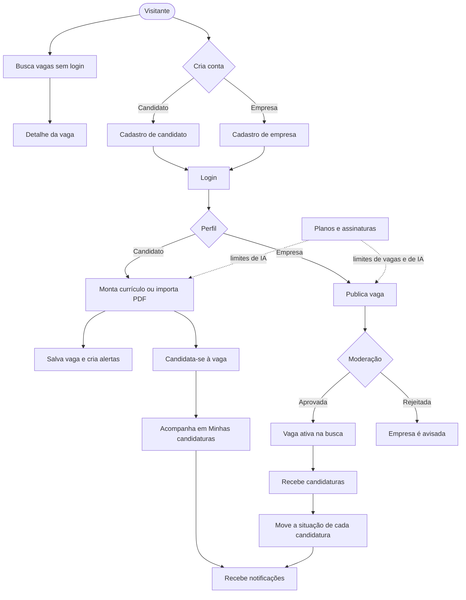
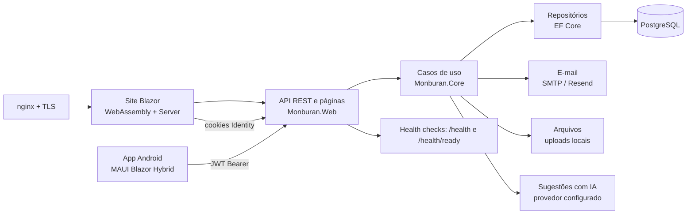
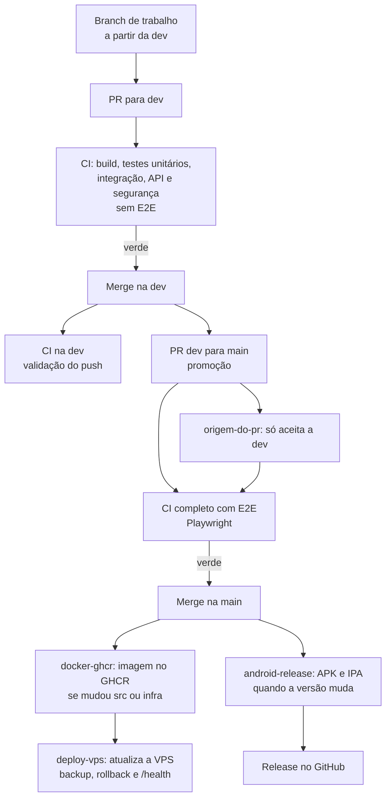
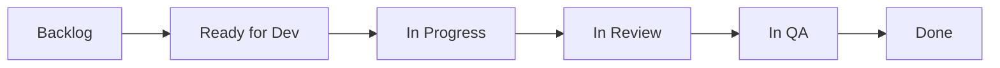

# Fluxos do projeto Monburan

Diagramas do funcionamento da plataforma e do fluxo de desenvolvimento. Estão em Mermaid, que o GitHub renderiza diretamente. As imagens usadas no relatório ficam em `docs/fluxogramas/`.

## 1. Fluxo de uso: candidato e empresa

## 2. Arquitetura

## 3. Fluxo de desenvolvimento e entrega

## 4. Fluxo do board (GitHub Projects)

Campos: *Fase* (Etapa 1 / Etapa 2) e *Prioridade* (Alta / Média / Baixa).
